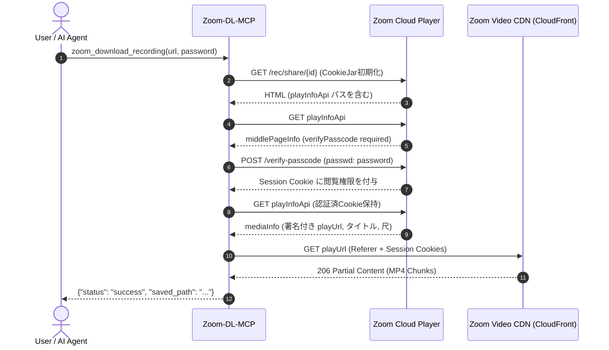

# Zoom-DL-MCP

[](LICENSE)
[](pyproject.toml)
[](https://modelcontextprotocol.io/)

> **Zero-dependency, browserless Zoom Cloud Recording Downloader & Model Context Protocol (MCP) Server.**  
> パスワード保護されたZoomクラウド録画を、ブラウザ起動不要・外部ライブラリ依存ゼロで高速ダウンロード可能なMCPサーバー＆CLIツールキット。

---

## 🌟 主な特徴 (Features)

- ⚡ **ゼロ外部依存 (Zero Dependencies)**: Python標準ライブラリ（`urllib`, `http.cookiejar`, `json`）のみで完結。`pip install` による追加ライブラリ導入は不要です。
- 🚀 **ヘッドレスブラウザ不要 (Browserless)**: PlaywrightやSelenium、Chromium等のブラウザ起動コストを完全排除。Zoom Unified Playerの内部セッションAPIをリバースエンジニアリングし、数ミリ秒でダウンロードを開始。
- 📦 **高速ストリーミング転送**: 署名付きCDN（AWS CloudFront / SSRWeb）から直接MP4ストリームを取得するため、回線上限（~50MB/s超）の最高スループットを発揮。
- 🤖 **トリプルインターフェース**:
  1. **MCP サーバー**: Antigravity, Claude Desktop, Cursor 等のAIエージェントから自然言語で利用可能。
  2. **CLI ツール**: ターミナルから引数指定でワンライナー実行。
  3. **Python モジュール**: 独自のスクリプトやデータパイプラインへ組み込み可能。

---

## 🏗️ アーキテクチャ (Architecture)



---

## 📥 インストール (Installation)

### 1. リポジトリのクローン
```bash
git clone https://github.com/wataraiharuki/Zoom-DL-MCP.git
cd Zoom-DL-MCP
```

### 2. ローカルインストール（任意）
```bash
pip install -e .
```
※ インストールを行わず、単体Pythonスクリプトとして直接実行することも可能です。

---

## 🤖 MCP (Model Context Protocol) サーバーの設定

Antigravity や Claude Desktop の設定ファイル（例: `claude_desktop_config.json` や Antigravity の MCP 設定）に以下を追記します。

### 設定例 (`claude_desktop_config.json`)
```json
{
  "mcpServers": {
    "zoom-dl": {
      "command": "python3",
      "args": [
        "/path/to/Zoom-DL-MCP/src/zoom_dl_mcp/server.py"
      ]
    }
  }
}
```

### 提供される MCP ツール一覧

| ツール名 | 引数 | 説明 |
| :--- | :--- | :--- |
| `zoom_get_recording_info` | `url` (str), `password` (str, optional) | 録画タイトル、尺、作成日時、ファイルサイズ、直接再生URLなどのメタデータを取得 |
| `zoom_download_recording` | `url` (str), `password` (str, optional), `output_path` (str, optional) | 録画動画（MP4）をローカルストレージへダウンロードして保存先パスを返却 |

---

## 💻 CLI (Command Line Interface) の使い方

### 基本ダウンロード
```bash
# パスワード付き録画のダウンロード
python3 src/zoom_dl_mcp/cli.py "https://zoom.us/rec/share/..." -p "your_passcode"

# pip install 済みの場合
zoom-dl "https://zoom.us/rec/share/..." -p "your_passcode"
```

### 保存先の指定
```bash
# 出力ディレクトリまたはファイル名を指定
zoom-dl "https://zoom.us/rec/share/..." -p "your_passcode" -o ./my_videos/
```

### メタデータ・直リンクの確認のみ（ダウンロードなし）
```bash
zoom-dl "https://zoom.us/rec/share/..." -p "your_passcode" --info-only
```

---

## 🐍 Python ライブラリとしての利用

```python
from zoom_dl_mcp import ZoomRecordingClient

client = ZoomRecordingClient()

# 1. メタデータ取得
metadata = client.fetch_recording_metadata(
    share_url="https://zoom.us/rec/share/...",
    password="your_passcode"
)

print(f"Title: {metadata.topic}")
print(f"Duration: {metadata.duration_seconds} sec")
print(f"Direct Signed CDN URL: {metadata.play_url}")

# 2. ファイルダウンロード
saved_path = client.download_file(
    metadata=metadata,
    destination_path="./downloads/lecture.mp4"
)
print(f"Saved to: {saved_path}")
```

---

## 🧪 テストの実行

```bash
python3 -m unittest discover -s tests
```

---

## ⚖️ 免責事項 (Disclaimer)

本ツールは、正当なアクセス権限（パスワードや共有URL）を保有するユーザーが自身の学習・アーカイブ目的でクラウド録画をローカルに保存することを支援するための技術検証およびユーティリティです。著作権法および利用サービスの規約を遵守した上で、ご自身の責任においてご利用ください。

---

## 📄 ライセンス

[MIT License](LICENSE) © 2026 Haruki Watarai
